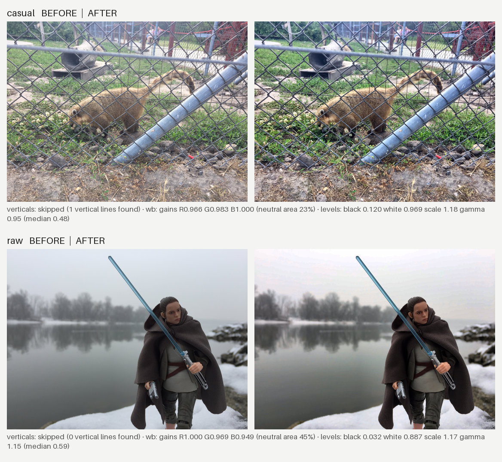

# photo-kit

Deterministic batch photo pipeline for marketing assets. One command produces platform-sized, metadata-free images, a review sheet, and optional branded cards. The model only reads reports and writes small JSON overrides.

> [!TIP]
> **Built to be cheap to run, for everyday use.**
>
> All pixel work is done by a plain Python script, not by the model. Claude only runs commands, reads short text reports and writes small JSON files, so the skill runs well on a small, inexpensive model (`haiku`) and uses few tokens: no images are generated, and review sheets are read once, after the text reports.
>
> It is a practical everyday helper for small businesses and personal projects, not a replacement for professional photo-editing software or a retoucher. Always check the results before you publish them.

## Main description
A Claude skill that wraps a deterministic Python script (`photo_kit.py`) for preparing real project photos for Google Ads, Google Business Profile, and LinkedIn. It handles colour correction, straightening of converging verticals, export to multiple platform sizes, metadata stripping, before/after review sheets, and optional branded post cards. All pixel decisions stay in the script; the model only reviews text reports and writes small JSON overrides.

## Example
The review sheet `process` writes for two casual phone photos (3264×2448, used as shot), with the settings in [examples/project-config.json](examples/project-config.json):



- **Top:** shadows deepened, the slight yellow cast removed, greens cleaner, phone noise reduced.
- **Bottom:** fog and snow fooled the automatic white balance, which shifted the scene slightly pink. This is what the review step is for: one line in [examples/overrides.json](examples/overrides.json) (`{"raw": {"wb": false}}`) and a rerun with `--only raw` keeps the cool tones and only corrects brightness and contrast.

The notes under each pair are the decisions written to `report.json`. [examples/cards.json](examples/cards.json) shows the card input used for the same run.

## Use cases
- Preparing Google Ads image assets (1.91:1, 1:1, 4:5) from real job photos.
- Creating Google Business Profile post images (4:3) with light correction.
- Generating LinkedIn feed images and branded cards with logo, brand colours, and approved headlines.
- Straightening phone photos of rooms and furniture in bulk.
- Cleaning compressed or re-saved JPEGs before publishing.
- Ranking a photo library by sharpness and resolution so the best candidates surface first.
- Reusing the same pipeline for any brand by supplying a project-specific config.

## Best practices
- Always start from original files, not chat-app copies.
- Review `report.json` and the before/after sheets before looking at individual images.
- Use `--only` for reruns so other photos stay untouched.
- Keep brand assets (logo, fonts, colours) in a project-specific config that deep-merges with `config.default.json`.
- Run `verify` and do a final human audit before any upload.
- Prefer the skill on a smaller model (`haiku`); the script does the pixel work.
- Never change the product itself (no recolouring, no AI fill, no defect removal). Cropping clutter is fine.
- Card headlines must come only from approved copy.

## Installation
Clone into your Claude skills folder and install the dependencies (Python 3.10+):

```bash
git clone https://github.com/R3app3r/photo-kit ~/.claude/skills/photo-kit
pip install -r ~/.claude/skills/photo-kit/requirements.txt
```

The skill is picked up when the next Claude Code session starts. Everything it needs is in this folder; no network access or API keys are used.

## Quick start
In Claude Code, ask for example: *"Use photo-kit to prepare the photos in ./shoot for Google Ads and LinkedIn."*  
Or run the script yourself:

```bash
python ~/.claude/skills/photo-kit/scripts/photo_kit.py process ./shoot ./shoot-out
python ~/.claude/skills/photo-kit/scripts/photo_kit.py verify ./shoot-out
```

Add `--config my-brand.json` (logo, fonts, colours, url) for branded cards. [GUIDE.md](GUIDE.md) is the full reference: commands, config keys, overrides and card format.

## Author
Marton Rozsas · marton.rozsas@gmail.com  
Feedback and issue reports are welcome.

## License
MIT, see [LICENSE](LICENSE). Provided as is, without warranty.
